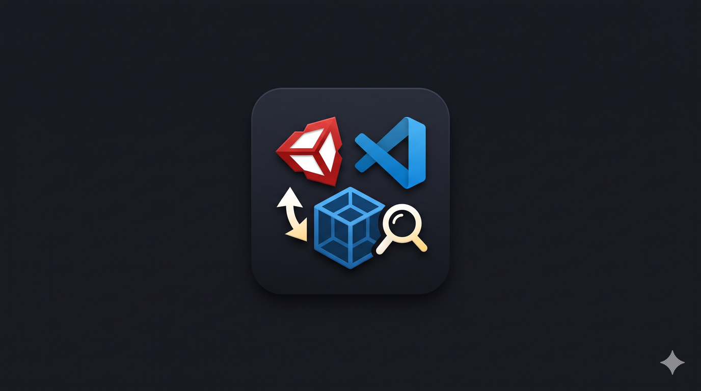
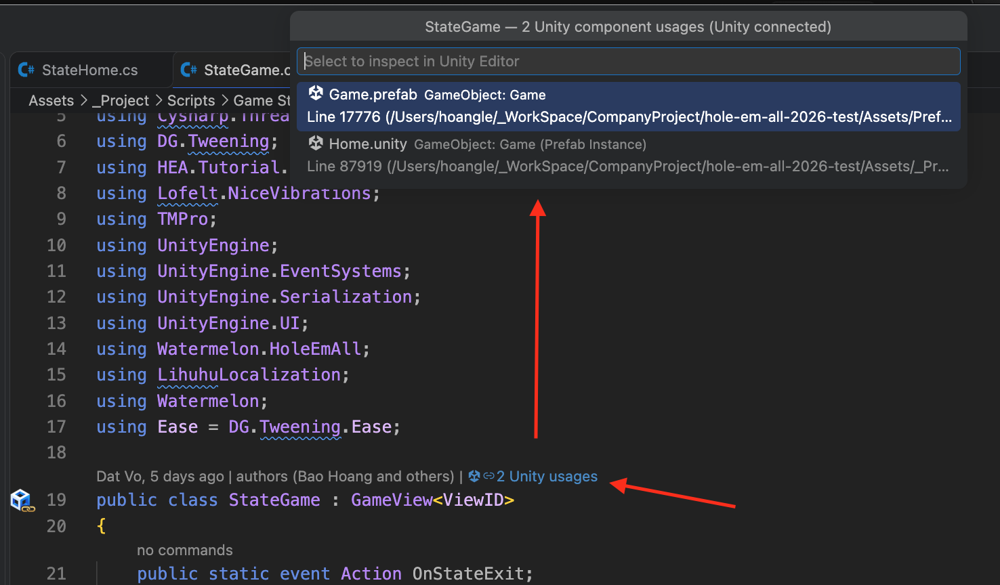
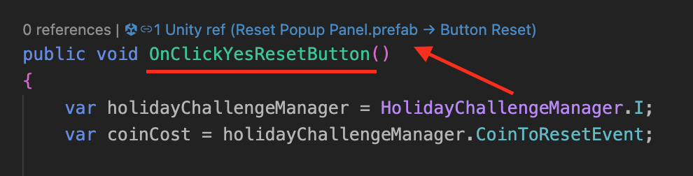

# Unity Scene References (VS Code & Cursor)

<p align="center">
  
</p>

Find Unity scene, prefab, and animation references directly in **Visual Studio Code**, **Cursor IDE**, and **Antigravity** — similar to JetBrains Rider's "Find Usages" for serialized UnityEvents, Animation Events, and MonoBehaviour Component attachments.

---

## 🚀 Key Features & Visual Walkthrough

### 1. 🔍 Tìm Class / MonoBehaviour Component Usages (Like Rider)
- Hiển thị CodeLens ngay trên dòng khai báo `class` cho biết có bao nhiêu GameObject/Prefab đang gắn Component này.
- Bấm vào CodeLens để mở menu QuickPick chi tiết: liệt kê chính xác file `.prefab` / `.unity`, tên GameObject, và số dòng tương ứng.
- **Tương tác trực tiếp với Unity**: Chọn item để Unity Editor tự mở Scene/Prefab và Ping/Focus ngay vào GameObject tương ứng trong Hierarchy!
- **Khử trùng lặp chuẩn xác**: Sử dụng GUID 32 ký tự từ `.cs.meta` để không bao giờ bị nhầm lẫn giữa các class trùng tên ở namespace khác nhau.

<p align="center">
  
</p>

---

### 2. ⚡ Tìm Action Button & UnityEvent References
- Hiển thị CodeLens trên đầu các hàm C# được liên kết với sự kiện Unity (như `Button.onClick`, `UnityEvent`, EventTrigger).
- Xem ngay hàm đang được gọi bởi GameObject nào trong Scene hay Prefab nào (ví dụ: `Reset Popup Panel.prefab → Button Reset`).
- Hỗ trợ cả **Animation Events** trong các file `.anim`.

<p align="center">
  
</p>

---

### 3. 🎨 Bộ nhận diện Icon mới: Gutter Icon & Vector CodeLens
- **Gutter Icon (Lề dòng code)**: Hiển thị icon màu 3D sắc nét (Khối lập phương Unity + Mắt xích vàng) ngay trước số dòng của các class và method có reference.
- **Vector CodeLens**: Tích hợp bộ font vector TrueType chuẩn (`$(unity-logo) $(link)`), đồng bộ với font chữ của editor, không bao giờ bị lỗi ô vuông `□`.

---

### 4. 🎯 Độ chính xác 100% (Zero False Positives)
- **Hỗ trợ PrefabInstance (`!u!1001`)**: Đọc chính xác `m_Modifications` (tên override `m_Name`), `m_CorrespondingSourceObject` và `m_PrefabInstance`.
- **Loại bỏ lỗi khớp nhầm `fileID: 0`**: Bỏ qua các stub block `stripped` không có target ID, ngăn ngừa Unity chọn nhầm các object sinh lúc runtime (như `[generated] UIParticleRenderer`).
- **Xác thực 2 chiều với Unity Editor**: Bridge script kiểm tra sự tồn tại thực tế của Component trên GameObject trước khi chọn.

---

### 5. ⚡ Incremental Cache cực nhanh (< 750ms)
- Lưu metadata và timestamp (`mtime`) xuống file `.vscode/unityrefs.cache.json`.
- Sử dụng bộ lọc nhanh trước khi tách dòng, bỏ qua hàng nghìn file YAML không chứa reference.
- **Tự động cập nhật**: FileWatcher tự quét lại các file vừa sửa khi bạn bấm Save trong Unity.
- **Tự làm sạch (Garbage Collection)**: Tự động loại bỏ cache của các file đã bị xóa trong Unity.

---

## 🛠️ Cài đặt (cho cả team)

### Cách 1: Một lệnh duy nhất (Khuyên dùng)

Mở Terminal và chạy (thay đường dẫn bằng project Unity của bạn):

```bash
curl -fsSL https://raw.githubusercontent.com/hoangledev/unity-scene-refs/main/install.sh | bash -s -- ~/path/to/UnityProject
```

Script sẽ:
1. Tải bản extension mới nhất và cài vào **mọi editor tìm thấy** (VS Code, Cursor, Antigravity IDE).
2. Copy `UnitySceneRefsBridge.cs` vào `Assets/Editor/UnitySceneRefs/` của project Unity (bỏ qua nếu project đã có bridge).

Sau đó: `Cmd + Shift + P` → **`Developer: Reload Window`**. Chạy lại đúng lệnh trên bất cứ lúc nào để **cập nhật** lên bản mới.

> Nếu bridge đã được commit sẵn vào repo game, chỉ cần bỏ đường dẫn project ở cuối lệnh.

---

### Cách 2: Cài thủ công

1. Tải [`unity-scene-refs.vsix`](https://github.com/hoangledev/unity-scene-refs/raw/main/dist/unity-scene-refs.vsix).
2. Trong VS Code / Cursor: `Cmd + Shift + P` → **`Extensions: Install from VSIX...`** → chọn file vừa tải.
3. Tải [`UnitySceneRefsBridge.cs`](https://github.com/hoangledev/unity-scene-refs/raw/main/unity-editor-script/UnitySceneRefsBridge.cs) và đặt vào một thư mục `Editor` bất kỳ trong `Assets/` của project Unity.
   *(Nếu project đã có `CursorBridge.cs` thì không cần — đừng để cả hai cùng lúc vì sẽ tranh cổng 7892.)*
4. `Cmd + Shift + P` → **`Developer: Reload Window`**.

> **An toàn cho cả team:** bridge chỉ chạy trong Unity Editor (bọc `#if UNITY_EDITOR`, không có trong bản build). Trên máy **không cài extension**, bridge hoàn toàn không làm gì — không mở cổng, không log — nên có thể commit thẳng vào repo game.

---

## 📦 Repo Structure

| Path | Purpose |
|------|---------|
| `src/` | Extension source code (TypeScript) |
| `icons/`, `images/` | Gutter/CodeLens icons, fonts and README screenshots |
| `unity-editor-script/UnitySceneRefsBridge.cs` | HTTP bridge script for Unity Editor (port 7892) |
| `dist/unity-scene-refs.vsix` | Latest pre-built package (used by `install.sh`) |
| `install.sh` | Installer for VS Code, Cursor and Antigravity IDE |

---

## ⚙️ Configuration Settings

Tuỳ chỉnh qua giao diện Settings hoặc file `.vscode/settings.json`:

| Setting | Type | Default | Description |
|---------|------|---------|-------------|
| `unitySceneRefs.enabled` | `boolean` | `true` | Bật/tắt toàn bộ CodeLens và Gutter icon |
| `unitySceneRefs.scanPath` | `string` | `"Assets"` | Thư mục quét tương đối trong workspace (ví dụ `"Assets"` hoặc `"Assets/_Project"`) |
| `unitySceneRefs.showComponentUsages` | `boolean` | `true` | Hiển thị CodeLens số lượng Component gắn trên class |
| `unitySceneRefs.includeAnimations` | `boolean` | `true` | Quét sự kiện trong các file `.anim` |
| `unitySceneRefs.includeAssets` | `boolean` | `false` | Quét thêm các file ScriptableObject `.asset` |
| `unitySceneRefs.bridgePort` | `number` | `7892` | Cổng HTTP kết nối với Unity Editor Bridge |

---

## 💡 Commands (`Cmd + Shift + P`)

- `Unity Scene Refs: Refresh Index` — Quét lại các file đã thay đổi (incremental scan).
- `Unity Scene Refs: Clear Cache & Re-index` — Xoá toàn bộ cache trên đĩa và quét lại từ đầu.
- `Unity Scene Refs: Show References` — Xem danh sách reference của method hiện tại.
- `Unity Scene Refs: Show Component Usages` — Xem danh sách GameObject đang gắn Component hiện tại.
- `Unity Scene Refs: Show Output Log` — Mở bảng log chi tiết tốc độ quét và trạng thái kết nối Unity.

---

## 🏗️ Build & phát hành bản mới

```bash
npm install
# tăng "version" trong package.json, rồi:
npm run release      # compile + đóng gói + cập nhật dist/unity-scene-refs.vsix
git add -A && git commit -m "Release vX.Y.Z" && git push
```

Ảnh trong README được trỏ tới GitHub (VS Code không hiển thị ảnh local trong tab Details), nên chỉ cần push là ảnh mới hiển thị.

---

## 📄 License

MIT
